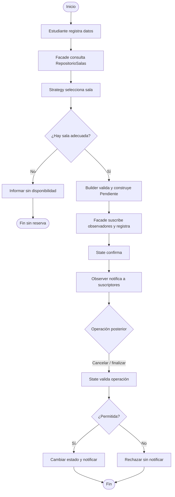
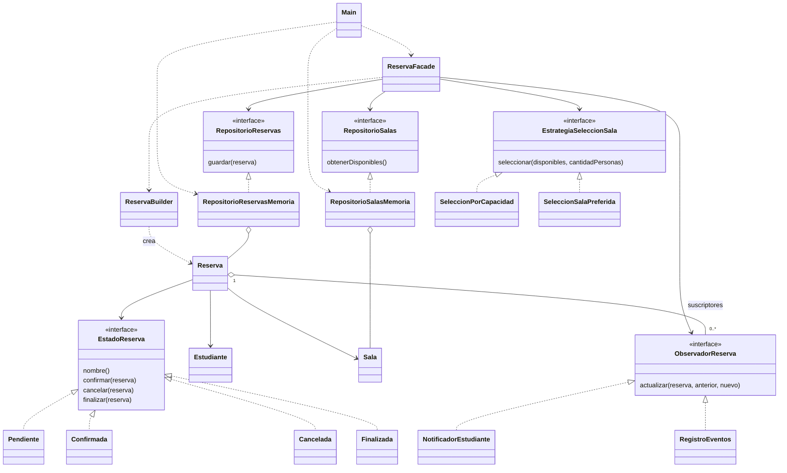

# Revisión del taller de reservas de biblioteca

Revisión del 6 de noviembre de 2026. Fuente: las 14 imágenes de la guía facilitadas y los archivos Java guardados. No se modificó src ni el Main original.

**Resultado:** implementación funcionalmente correcta para el alcance de la guía. P01-P11 superadas; 37 comprobaciones correctas. No es una certificación de un sistema de reservas real.

## Cómo usar las pruebas

Cada carpeta `pruebas/estacionN` contiene un **Main.java completo**. Para probar desde tu IDE, respalda tu Main actual, copia temporalmente el contenido del archivo de la estación en él y ejecútalo. Después restaura el original. No pongas varios Main.java del paquete biblioteca dentro de src a la vez. Los auxiliares comprobar, rechaza y datos son código exclusivo de pruebas, no cambios al código del taller.

También puedes ejecutar `ejecutar_pruebas.ps1` para correr todas sin reemplazar Main. Los fragmentos nuevos de prueba están separados de las clases originales, respetando tu restricción de no añadir lógica ajena a ellas.

## Estación 1. Comprender el problema y modelar el flujo

**Revisión:** El flujo implementado es coherente: consulta, selección, construcción, suscripción de observadores, registro y confirmación. La estación exige además un diagrama y explicar responsabilidades; el código por sí solo no completa esta entrega.

**Prueba y resultado:** Revisión conceptual: siga una solicitud para cuatro personas hasta Confirmada y una para diez personas hasta la salida sin reserva. No hay una prueba Java independiente para dibujar un flujo.

**Punto de control:** Main recoge entradas y configura dependencias; Strategy selecciona; Builder construye y valida; los repositorios consultan y almacenan; Facade coordina; State autoriza transiciones; Observer comunica los cambios. Una clase que hiciera todo tendría baja cohesión porque mezclaría motivos distintos de cambio.

No requiere código en Main. Diagrama:


## Estación 2. Crear el dominio

**Revisión:** Correcto. Estudiante y Sala validan entradas, mantienen atributos privados y finales, y exponen getters. Las salas tienen capacidades 2, 4, 6 y 8.

**Prueba y resultado:** Mostrar las cuatro salas, comprobar capacidades y nombre del estudiante; rechazar identificador vacío y capacidad cero. Resultado: ocho comprobaciones correctas.

**Punto de control:** private protege el acceso y final impide reasignar los campos tras construir el objeto. En estas clases, los campos son String e int y no hay setters, lo que mantiene estables los datos. final por sí solo no vuelve inmutable cualquier objeto referenciado.

**Código completo para Main.java (solo estación 2):**
```java
package biblioteca;

import java.time.LocalDate;
import java.time.LocalTime;
import java.util.List;

public class Main {
    private static int comprobaciones;

    public static void main(String[] args) {
        estacion2();
    }

    private static void comprobar(boolean condicion, String descripcion) {
        if (!condicion) throw new AssertionError(descripcion);
        comprobaciones++;
        System.out.println("OK: " + descripcion);
    }

    private static void rechaza(Runnable accion, String descripcion) {
        try {
            accion.run();
        } catch (IllegalStateException | IllegalArgumentException ex) {
            comprobar(true, descripcion + " | " + ex.getMessage());
            return;
        }
        throw new AssertionError("No rechazo: " + descripcion);
    }

    private static ReservaBuilder datos() {
        return new ReservaBuilder()
            .estudiante(new Estudiante("E001", "Laura"))
            .fecha(LocalDate.now().plusDays(7))
            .horaInicio(LocalTime.of(14, 0))
            .duracionHoras(2).cantidadPersonas(4)
            .sala(new Sala("B", "Sala B", 4));
    }

    public static void estacion2() {
        System.out.println("\n=== ESTACION 2: DOMINIO ===");
        List<Sala> salas = new RepositorioSalasMemoria().obtenerDisponibles();
        salas.forEach(System.out::println);
        comprobar(salas.size() == 4, "Cuatro salas");
        for (int i = 0; i < salas.size(); i++) {
            comprobar(salas.get(i).getCapacidad() == (i + 1) * 2,
                "Capacidad de sala " + salas.get(i).getCodigo());
        }
        comprobar(new Estudiante("E001", "Laura").getNombre().equals("Laura"),
            "Estudiante conserva su nombre");
        rechaza(() -> new Estudiante("", "Laura"), "Identificador vacio");
        rechaza(() -> new Sala("X", "Sala X", 0), "Capacidad cero");
    }
}
```

## Estación 3. Construir reservas con Builder

**Revisión:** Correcto. ReservaBuilder centraliza datos obligatorios, fecha no pasada, duración y personas positivas, y capacidad suficiente. Genera el código y crea una reserva Pendiente. La dependencia de State es acumulativa, tal como advierte la guía.

**Prueba y resultado:** P01: construir una reserva válida; P02: omitir estudiante. Añadidos: capacidad insuficiente, fecha pasada, duración cero y personas cero. Resultado: seis comprobaciones correctas.

**Punto de control:** Estas validaciones aseguran que la reserva nazca válida y deben permanecer en Builder, evitando repetirlas en Main. Los métodos encadenados hacen explícito el significado de cada dato y reducen errores de orden de argumentos.

**Código completo para Main.java (solo estación 3):**
```java
package biblioteca;

import java.time.LocalDate;
import java.time.LocalTime;
import java.util.List;

public class Main {
    private static int comprobaciones;

    public static void main(String[] args) {
        estacion3();
    }

    private static void comprobar(boolean condicion, String descripcion) {
        if (!condicion) throw new AssertionError(descripcion);
        comprobaciones++;
        System.out.println("OK: " + descripcion);
    }

    private static void rechaza(Runnable accion, String descripcion) {
        try {
            accion.run();
        } catch (IllegalStateException | IllegalArgumentException ex) {
            comprobar(true, descripcion + " | " + ex.getMessage());
            return;
        }
        throw new AssertionError("No rechazo: " + descripcion);
    }

    private static ReservaBuilder datos() {
        return new ReservaBuilder()
            .estudiante(new Estudiante("E001", "Laura"))
            .fecha(LocalDate.now().plusDays(7))
            .horaInicio(LocalTime.of(14, 0))
            .duracionHoras(2).cantidadPersonas(4)
            .sala(new Sala("B", "Sala B", 4));
    }

    public static void estacion3() {
        System.out.println("\n=== ESTACION 3: BUILDER ===");
        Reserva r = datos().build();
        System.out.println(r);
        comprobar(r.getNombreEstado().equals("Pendiente")
            && r.getCantidadPersonas() == 4 && r.getSala().getCodigo().equals("B"),
            "P01: construccion valida, estado inicial Pendiente");
        rechaza(() -> datos().estudiante(null).build(), "P02: sin estudiante");
        rechaza(() -> datos().cantidadPersonas(5).build(), "Capacidad insuficiente");
        rechaza(() -> datos().fecha(LocalDate.now().minusDays(1)).build(), "Fecha pasada");
        rechaza(() -> datos().duracionHoras(0).build(), "Duracion cero");
        rechaza(() -> datos().cantidadPersonas(0).build(), "Personas cero");
    }
}
```

## Estación 4. Seleccionar salas con Strategy

**Revisión:** Correcto. SeleccionPorCapacidad filtra y elige el mínimo suficiente; SeleccionSalaPreferida busca el código sin distinguir mayúsculas y comprueba capacidad. Ambas devuelven Optional.

**Prueba y resultado:** P03: cuatro personas por capacidad -> B. P04: preferida C para cuatro -> C. P05: preferida B para siete -> vacío. También se comprobó que para tres personas el mínimo suficiente es B. Cuatro comprobaciones correctas.

**Punto de control:** Una tercera estrategia podría elegir la sala de mayor capacidad: bastaría crear otra clase que implemente EstrategiaSeleccionSala y elegirla al configurar Main; no se cambia Facade ni las estrategias existentes. Para seleccionar por equipamiento también habría que modelar ese dato en Sala o consultarlo: el modelo actual no lo contiene.

**Código completo para Main.java (solo estación 4):**
```java
package biblioteca;

import java.time.LocalDate;
import java.time.LocalTime;
import java.util.List;

public class Main {
    private static int comprobaciones;

    public static void main(String[] args) {
        estacion4();
    }

    private static void comprobar(boolean condicion, String descripcion) {
        if (!condicion) throw new AssertionError(descripcion);
        comprobaciones++;
        System.out.println("OK: " + descripcion);
    }

    private static void rechaza(Runnable accion, String descripcion) {
        try {
            accion.run();
        } catch (IllegalStateException | IllegalArgumentException ex) {
            comprobar(true, descripcion + " | " + ex.getMessage());
            return;
        }
        throw new AssertionError("No rechazo: " + descripcion);
    }

    private static ReservaBuilder datos() {
        return new ReservaBuilder()
            .estudiante(new Estudiante("E001", "Laura"))
            .fecha(LocalDate.now().plusDays(7))
            .horaInicio(LocalTime.of(14, 0))
            .duracionHoras(2).cantidadPersonas(4)
            .sala(new Sala("B", "Sala B", 4));
    }

    public static void estacion4() {
        System.out.println("\n=== ESTACION 4: STRATEGY ===");
        List<Sala> salas = new RepositorioSalasMemoria().obtenerDisponibles();
        comprobar(new SeleccionPorCapacidad().seleccionar(salas, 4)
            .orElseThrow().getCodigo().equals("B"), "P03: capacidad para 4 -> B");
        comprobar(new SeleccionSalaPreferida("C").seleccionar(salas, 4)
            .orElseThrow().getCodigo().equals("C"), "P04: preferida C para 4 -> C");
        comprobar(new SeleccionSalaPreferida("B").seleccionar(salas, 7).isEmpty(),
            "P05: preferida B para 7 -> vacio");
        comprobar(new SeleccionPorCapacidad().seleccionar(salas, 3)
            .orElseThrow().getCodigo().equals("B"), "Elige la menor capacidad suficiente");
    }
}
```

## Estación 5. Acceso a datos y Facade

**Revisión:** Correcto en su versión final. Los repositorios separan contratos de implementaciones en memoria. Facade recibe dependencias, selecciona, construye, suscribe, registra y confirma. El constructor de tres argumentos es la ampliación de la estación 6.

**Prueba y resultado:** P06: comprobar que la reserva retornada es la misma almacenada y está Confirmada. P10: solicitar diez personas y comprobar Optional vacío sin aumentar el repositorio. Dos comprobaciones correctas.

**Punto de control:** Main hace una operación de alto nivel y no repite el orden interno del caso de uso. Para sustituir memoria por una fuente real se implementa RepositorioSalas o RepositorioReservas y se inyecta en Main; la coordinación de Facade permanece igual si se conserva el contrato.

**Código completo para Main.java (solo estación 5):**
```java
package biblioteca;

import java.time.LocalDate;
import java.time.LocalTime;
import java.util.List;

public class Main {
    private static int comprobaciones;

    public static void main(String[] args) {
        estacion5();
    }

    private static void comprobar(boolean condicion, String descripcion) {
        if (!condicion) throw new AssertionError(descripcion);
        comprobaciones++;
        System.out.println("OK: " + descripcion);
    }

    private static void rechaza(Runnable accion, String descripcion) {
        try {
            accion.run();
        } catch (IllegalStateException | IllegalArgumentException ex) {
            comprobar(true, descripcion + " | " + ex.getMessage());
            return;
        }
        throw new AssertionError("No rechazo: " + descripcion);
    }

    private static ReservaBuilder datos() {
        return new ReservaBuilder()
            .estudiante(new Estudiante("E001", "Laura"))
            .fecha(LocalDate.now().plusDays(7))
            .horaInicio(LocalTime.of(14, 0))
            .duracionHoras(2).cantidadPersonas(4)
            .sala(new Sala("B", "Sala B", 4));
    }

    public static void estacion5() {
        System.out.println("\n=== ESTACION 5: FACADE ===");
        RepositorioReservasMemoria repositorio = new RepositorioReservasMemoria();
        ReservaFacade fachada = new ReservaFacade(new RepositorioSalasMemoria(),
            repositorio, List.of());
        Reserva r = fachada.realizarReserva(new Estudiante("E001", "Laura"),
            LocalDate.now().plusDays(7), LocalTime.of(14, 0), 2, 4,
            new SeleccionPorCapacidad()).orElseThrow();
        comprobar(r.getNombreEstado().equals("Confirmada")
            && repositorio.obtenerTodas().size() == 1
            && repositorio.obtenerTodas().get(0) == r,
            "P06: reserva registrada y confirmada");
        comprobar(fachada.realizarReserva(new Estudiante("E003", "Camila"),
            LocalDate.now().plusDays(7), LocalTime.of(9, 0), 2, 10,
            new SeleccionPorCapacidad()).isEmpty()
            && repositorio.obtenerTodas().size() == 1,
            "P10: para 10 personas no crea ni registra otra reserva");
    }
}
```

## Estación 6. Notificar con Observer

**Revisión:** Correcto. Reserva guarda suscriptores por interfaz, permite agregarlos y retirarlos, y notifica desde cambiarEstado. Facade los conecta antes de confirmar. List.copyOf evita iterar directamente sobre una lista que un suscriptor pudiera modificar.

**Prueba y resultado:** P07: ambos observadores reciben confirmación. P08: cancelación válida notifica. P09: confirmar cancelada se rechaza sin emitir avisos. Además se retira un observador y se comprueba que no recibe eventos. Cinco comprobaciones; los contadores son auxiliares de prueba y se ejecutan junto con las dos clases reales.

**Punto de control:** Reserva conoce ObservadorReserva, no la forma de notificar ni registrar. Un nuevo observador puede añadirse sin cambiar Reserva. El texto actual concatena "su reserva" con el código sin espacio; es una diferencia visual respecto a la guía y no afecta al patrón.

**Código completo para Main.java (solo estación 6):**
```java
package biblioteca;

import java.time.LocalDate;
import java.time.LocalTime;
import java.util.List;

public class Main {
    private static int comprobaciones;

    public static void main(String[] args) {
        estacion6();
    }

    private static void comprobar(boolean condicion, String descripcion) {
        if (!condicion) throw new AssertionError(descripcion);
        comprobaciones++;
        System.out.println("OK: " + descripcion);
    }

    private static void rechaza(Runnable accion, String descripcion) {
        try {
            accion.run();
        } catch (IllegalStateException | IllegalArgumentException ex) {
            comprobar(true, descripcion + " | " + ex.getMessage());
            return;
        }
        throw new AssertionError("No rechazo: " + descripcion);
    }

    private static ReservaBuilder datos() {
        return new ReservaBuilder()
            .estudiante(new Estudiante("E001", "Laura"))
            .fecha(LocalDate.now().plusDays(7))
            .horaInicio(LocalTime.of(14, 0))
            .duracionHoras(2).cantidadPersonas(4)
            .sala(new Sala("B", "Sala B", 4));
    }

    public static void estacion6() {
        System.out.println("\n=== ESTACION 6: OBSERVER ===");
        Reserva r = datos().build();
        int[] avisos = {0, 0};
        ObservadorReserva primero = (reserva, anterior, nuevo) -> {
            avisos[0]++;
            System.out.println("Observador 1: " + anterior + " -> " + nuevo);
        };
        ObservadorReserva segundo = (reserva, anterior, nuevo) -> {
            avisos[1]++;
            System.out.println("Observador 2: " + anterior + " -> " + nuevo);
        };
        r.agregarObservador(new NotificadorEstudiante());
        r.agregarObservador(new RegistroEventos());
        r.agregarObservador(primero);
        r.agregarObservador(segundo);
        r.confirmar();
        comprobar(avisos[0] == 1 && avisos[1] == 1,
            "P07: ambos suscriptores reciben la confirmacion");
        r.cancelar();
        comprobar(r.getNombreEstado().equals("Cancelada")
            && avisos[0] == 2 && avisos[1] == 2,
            "P08: cancelar confirmada cambia estado y notifica");
        rechaza(r::confirmar, "P09: confirmar cancelada se rechaza");
        comprobar(avisos[0] == 2 && avisos[1] == 2,
            "P09: rechazo no genera notificaciones");

        Reserva otra = datos().build();
        otra.agregarObservador(primero);
        otra.retirarObservador(primero);
        otra.confirmar();
        comprobar(avisos[0] == 2, "Observador retirado no recibe avisos");
    }
}
```

## Estación 7. Controlar el ciclo de vida con State

**Revisión:** Correcto. Pendiente permite confirmar o cancelar; Confirmada permite cancelar o finalizar; Cancelada y Finalizada rechazan todas las operaciones. Los rechazos lanzan excepción antes de cambiarEstado, por lo que no notifican.

**Prueba y resultado:** Se prueban las cuatro transiciones válidas y las ocho combinaciones inválidas entre cuatro estados y tres operaciones, repartidas entre las estaciones 6 y 7. P11 comprueba finalizar una confirmada y recibir evento. Once comprobaciones en esta estación.

**Punto de control:** Frente a una Reserva llena de if/else, cada estado concentra sus reglas. Agregar un estado requiere su clase y actualizar las transiciones que conduzcan a él; no significa que ningún archivo existente vaya a cambiar.

**Código completo para Main.java (solo estación 7):**
```java
package biblioteca;

import java.time.LocalDate;
import java.time.LocalTime;
import java.util.List;

public class Main {
    private static int comprobaciones;

    public static void main(String[] args) {
        estacion7();
    }

    private static void comprobar(boolean condicion, String descripcion) {
        if (!condicion) throw new AssertionError(descripcion);
        comprobaciones++;
        System.out.println("OK: " + descripcion);
    }

    private static void rechaza(Runnable accion, String descripcion) {
        try {
            accion.run();
        } catch (IllegalStateException | IllegalArgumentException ex) {
            comprobar(true, descripcion + " | " + ex.getMessage());
            return;
        }
        throw new AssertionError("No rechazo: " + descripcion);
    }

    private static ReservaBuilder datos() {
        return new ReservaBuilder()
            .estudiante(new Estudiante("E001", "Laura"))
            .fecha(LocalDate.now().plusDays(7))
            .horaInicio(LocalTime.of(14, 0))
            .duracionHoras(2).cantidadPersonas(4)
            .sala(new Sala("B", "Sala B", 4));
    }

    public static void estacion7() {
        System.out.println("\n=== ESTACION 7: STATE ===");
        Reserva r = datos().build();
        rechaza(r::finalizar, "No se finaliza una Pendiente");
        comprobar(r.getNombreEstado().equals("Pendiente"), "Rechazo conserva estado");
        r.confirmar();
        rechaza(r::confirmar, "No se confirma dos veces");
        int[] eventos = {0};
        r.agregarObservador((reserva, anterior, nuevo) -> eventos[0]++);
        r.finalizar();
        comprobar(r.getNombreEstado().equals("Finalizada") && eventos[0] == 1,
            "P11: finalizar confirmada cambia estado y notifica");
        rechaza(r::cancelar, "No se cancela una Finalizada");
        rechaza(r::confirmar, "No se confirma una Finalizada");
        rechaza(r::finalizar, "No se finaliza dos veces");
        comprobar(eventos[0] == 1 && r.getNombreEstado().equals("Finalizada"),
            "Estado terminal conserva estado y no notifica rechazos");
        Reserva pendiente = datos().build();
        pendiente.cancelar();
        comprobar(pendiente.getNombreEstado().equals("Cancelada"), "Pendiente -> Cancelada");
        rechaza(pendiente::cancelar, "No se cancela dos veces");
        rechaza(pendiente::finalizar, "No se finaliza una Cancelada");
    }
}
```

## Estación 8. Integrar la aplicación

**Revisión:** Correcto. El Main original compila y termina sin excepciones no controladas. Configura dependencias y presenta los escenarios de la guía. Los identificadores de Camila y Samuel son E004 y E005 en lugar de E003 y E004; es una diferencia de datos de ejemplo sin efecto funcional.

**Prueba y resultado:** Ejecutar el Main original: Laura B confirmada y luego cancelada; rechazo de confirmar cancelada; Andrés C; Camila sin sala; Samuel A finalizada. Una comprobación de terminación más la revisión de la salida, guardada como evidencia.

**Punto de control:** El Main original no cubre por sí solo P02 ni P05. Las pruebas auxiliares completan la matriz P01-P11. La lista fija simula disponibilidad: no detecta cruces horarios ni persiste entre ejecuciones, y una sala puede reaparecer en varias reservas.

**Código completo para Main.java (solo estación 8):**
```java
package biblioteca;
import java.util.List;
import java.time.LocalTime;
import java.time.LocalDate;

public class Main {
    public static void main(String[] args) {
        RepositorioSalas salas = new RepositorioSalasMemoria();
        RepositorioReservasMemoria reservas = new RepositorioReservasMemoria();

        List<ObservadorReserva> observadores = List.of(
            new NotificadorEstudiante(),
            new RegistroEventos()
        );
    ReservaFacade fachada = new ReservaFacade(salas, reservas, observadores);

    Estudiante laura = new Estudiante("E001", "Laura");

    System.out.println("=== ESCENARIO PRINCIPAL ===");
    Reserva reserva = fachada.realizarReserva(
        laura,
        LocalDate.now().plusDays(7),
        LocalTime.of(14,0),
        2,
        4,
        new SeleccionPorCapacidad()
    ).orElseThrow();

    System.out.println(reserva);
    System.out.println("\nLaura cancela la reserva: ");
    reserva.cancelar();
    System.out.println(reserva);

    System.out.println("\nIntento invalido: confirmar una reserva cancelada");
    try{
        reserva.confirmar();
    } catch (IllegalStateException ex) {
        System.out.println("Operacion rechazada: " + ex.getMessage());
        }
    System.out.println("\n=== PRUEBA DE LA SALA PREFERIDA ===");
    fachada.realizarReserva(
        new Estudiante("E002", "Andres"),
        LocalDate.now().plusDays(8),
        LocalTime.of(10,0),
        2,
        4,
        new SeleccionSalaPreferida("C")
        ).ifPresent(System.out::println);

    System.out.println("\n=== PRUEBA SIN SALA ADECUADA ===");
    fachada.realizarReserva(
        new Estudiante("E004", "Camila"),
        LocalDate.now().plusDays(9),
        LocalTime.of(9, 0),
        2,
         10,
        new SeleccionPorCapacidad()
    );

    System.out.println("\n=== PRUEBA DE FINALIZACION ===");
    Reserva otra = fachada.realizarReserva(
        new Estudiante("E005", "Samuel"),
        LocalDate.now().plusDays(10) ,
        LocalTime.of(11, 0),
         1,
          2,
        new SeleccionPorCapacidad()
    ).orElseThrow();
    otra.finalizar();
    System.out.println(otra);
    }


}


```

## Matriz de trazabilidad

| ID | Requisito / escenario | Esperado | Clases | Patrón | Estación | Resultado |
|---|---|---|---|---|---|---|

| P01 | Construcción completa | Reserva válida, Pendiente | ReservaBuilder, Reserva | Builder | 3 | OK |

| P02 | Sin estudiante | Rechazo con mensaje | ReservaBuilder | Builder | 3 | OK |

| P03 | Capacidad para 4 | Sala B | SeleccionPorCapacidad | Strategy | 4 | OK |

| P04 | Preferida C para 4 | Sala C | SeleccionSalaPreferida | Strategy | 4 | OK |

| P05 | Preferida B para 7 | Optional vacío | SeleccionSalaPreferida | Strategy | 4 | OK |

| P06 | Reserva exitosa | Registrada y Confirmada | ReservaFacade, RepositorioReservasMemoria | Facade | 5 | OK |

| P07 | Cambio a Confirmada | Ambos observadores avisados | Reserva, Pendiente, NotificadorEstudiante, RegistroEventos | Observer + State | 6 | OK |

| P08 | Cancelar Confirmada | Cancelada y evento | Confirmada, Cancelada, Reserva | State + Observer | 6 | OK |

| P09 | Confirmar Cancelada | Rechazo, sin evento | Cancelada, Reserva | State | 6 | OK |

| P10 | Solicitud para 10 | No crea ni registra | SeleccionPorCapacidad, ReservaFacade | Strategy + Facade | 5 | OK |

| P11 | Finalizar Confirmada | Finalizada y evento | Confirmada, Finalizada, Reserva | State + Observer | 7 | OK |

## Diagrama de clases actualizado


## SOLID y antipatrones

- **SRP:** Builder construye; Strategy selecciona; State controla transiciones; Observer notifica; repositorios almacenan; Facade coordina. Evita una clase que concentre todo.

- **OCP:** Se pueden añadir estrategias y observadores implementando sus interfaces. No hace falta agregar un switch en Facade por cada algoritmo.

- **LSP:** Las estrategias devuelven una sala válida o Optional vacío según el contrato. Los estados implementan todas las operaciones; rechazar una transición es parte del contrato de State, no una promesa de que todas estén permitidas.

- **ISP:** Las interfaces de estrategia, observador y repositorios son pequeñas y específicas; no obligan a implementar operaciones ajenas.

- **DIP:** Facade depende de interfaces de repositorio y estrategia; Reserva depende de interfaces de estado y observador. Main selecciona las implementaciones concretas.


No se observó God Object, selección mediante switch ni creación de notificadores concretos dentro de Reserva. La capacidad se filtra al seleccionar y se valida al construir: son garantías distintas (elegir una candidata frente a impedir un objeto inválido), no hay que quitar una a ciegas. No se añadieron base de datos ni interfaz gráfica, conforme al alcance.

## Reflexiones 14-22: respuestas base para estudiar y adaptar

### 14. Responsabilidades separadas
Se separaron consulta, selección, construcción, persistencia, coordinación, estados y notificación. Una única clase acumularía cambios por motivos distintos y dificultaría probar cada parte.

### 15. Ventaja de Builder
Los nombres de sus métodos explican cada dato y build centraliza las validaciones; un constructor con numerosos argumentos facilita confundir posiciones.

### 16. Extensión de Strategy
Se crea una implementación de EstrategiaSeleccionSala y se pasa a realizarReserva. Facade invoca el contrato sin conocer el algoritmo concreto.

### 17. Complejidad oculta por Facade
Oculta consulta, selección, construcción, suscripción, registro y confirmación. Main no depende del orden de esos pasos.

### 18. Desacoplamiento de Observer
Reserva invoca actualizar sobre ObservadorReserva. Los suscriptores deciden cómo notificar o registrar sin introducir sus detalles dentro de Reserva.

### 19. Aporte de State
Un String solo guarda una etiqueta; State reúne las operaciones permitidas y los rechazos de cada estado y evita modificar libremente la etiqueta desde Main.

### 20. Dos principios SOLID
SRP: ReservaBuilder valida y construye mientras RegistroEventos registra cambios. DIP: ReservaFacade recibe RepositorioSalas y RepositorioReservas por sus interfaces.

### 21. Antipatrón evitado
God Object: Main configura y ejecuta ejemplos, pero no contiene las reglas de selección, validación ni transición. Esas reglas están en sus componentes.

### 22. Disponibilidad simulada
RepositorioSalasMemoria siempre devuelve la misma lista; no considera fecha ni hora ni bloquea salas. Para una agenda real habría que ampliar el contrato de consulta con el intervalo e implementar un repositorio que detecte solapamientos y persista reservas.

## Conclusión técnica: borrador
Borrador para personalizar: La separación mediante Builder, Strategy, Facade, Observer y State permite localizar las reglas y probarlas por componente. Una decisión central es inyectar repositorios y observadores desde Main, manteniendo las abstracciones en el dominio. La ejecución revisada superó P01-P11 y 37 comprobaciones. La integración entre cambios de estado y notificaciones exige conectar los observadores antes de confirmar. Como mejora futura propondría disponibilidad por intervalo y persistencia, con una consulta que considere fecha, hora y duración. Este prototipo es de consola, usa una lista fija, no controla solapamientos ni conserva datos al terminar. Antes de entregar, añade las dificultades que tú experimentaste y explica cómo las resolviste; este texto no afirma experiencias personales tuyas.

## Entregables y evidencias

1. Proyecto: `proyecto_biblioteca.zip` contiene src y un README de ejecución.
2. PDF: `informe_biblioteca.pdf` reúne diagramas, patrones, resultados, matriz, SOLID, reflexiones y conclusión base. Revisa y personaliza la conclusión antes de entregar como documento individual.
3. Evidencias: `evidencias/resultados.txt` conserva la salida real. Las imágenes por estación son representaciones fieles de esa salida, **no capturas del IDE**. Si la docente exige capturas de pantalla de tu ejecución, usa los Main preparados y captura tu consola; no presentes las imágenes generadas como capturas propias.
4. Matriz: incorporada en PDF y en esta guía; el CSV permite editarla.
5. Diagramas: fuentes Mermaid editables y PNG incluidos.

## Diferencias menores respecto a las imágenes

Falta un espacio después de "su reserva" en NotificadorEstudiante; algunos mensajes no llevan tildes o punto final; los ID de Camila y Samuel difieren; hay cambios de sangría. No alteran el comportamiento. No se corrigieron porque no era necesario modificar el programa para esta revisión.

## Referencia
Guía práctica de Análisis y diseño de sistemas de información, laboratorio individual de patrones de diseño en Java, imágenes proporcionadas por el estudiante (sin datos de autor o edición visibles). Análisis y material auxiliar preparados con asistencia de Codex.
